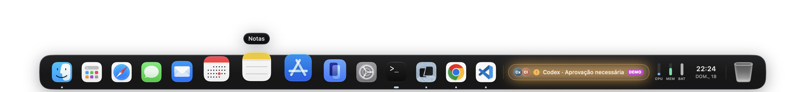
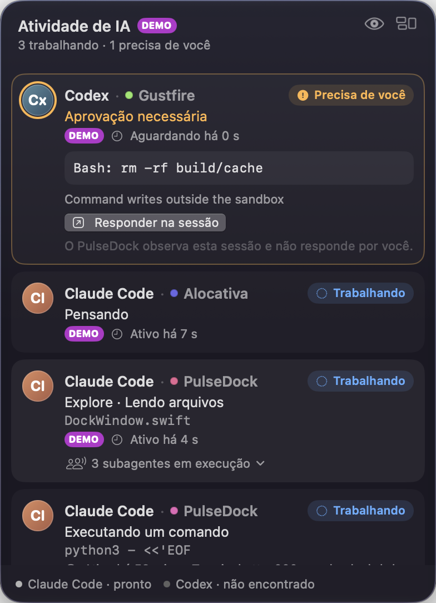
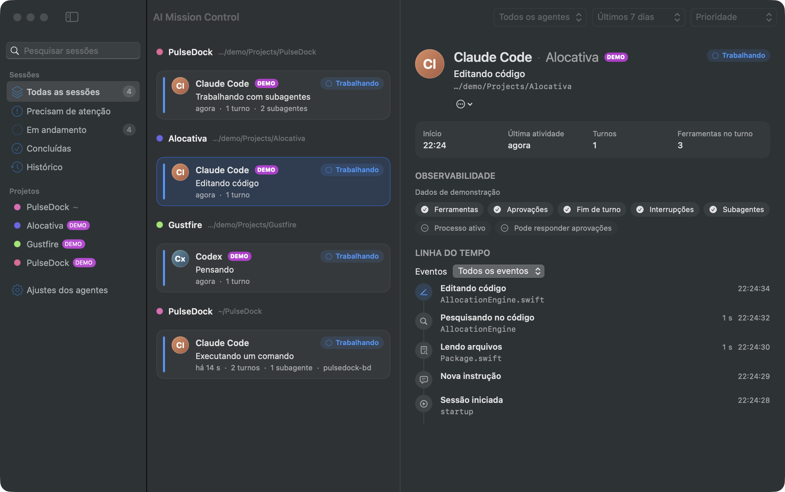

# PulseDock

**Your Mac. Your apps. Your AI agents. One living Dock.**

PulseDock é um dock nativo para macOS (Swift 6, SwiftUI + AppKit) que serve como lançador de apps do dia a
dia e mostra, em tempo real e sem inventar nada, o que os seus agentes de programação estão fazendo: Claude
Code e Codex trabalhando, esperando você, terminando ou falhando. Um clique leva de volta à sessão certa.



| Agent Card | AI Mission Control |
| --- | --- |
|  |  |

## O que ele faz

- **Dock completo**: apps fixados e em execução, abrir e alternar, arrastar para reordenar ou remover, soltar
  arquivos, menu contextual nativo, magnificação orgânica com alvo de clique estável, auto-hide, vários
  monitores, Lixo e widgets (Relógio, Saúde do Sistema, Tocando Agora, Quick Launch).
- **Pulse Glass**: Liquid Glass no macOS 26+, com material nativo equivalente no macOS 15. Temas Native Glass,
  Midnight e Aurora.
- **Ambientes**: Desenvolvimento, Criativo, Pessoal e Foco, cada um com apps, tema, widgets e filtro de IA
  próprios.
- **Agent Pulse**: uma cápsula viva no dock. Fica discreta sem agentes, mostra a atividade concreta
  ("Claude · Executando testes"), fica âmbar quando alguém precisa de você e confirma o fim do turno sem
  interromper.
- **Agent Card** e **AI Mission Control**: sessões por prioridade, projetos detectados automaticamente,
  subagentes, tarefas, timeline e histórico pesquisável.
- **Estados honestos**: tudo vem de eventos oficiais. Silêncio vira "Sem atualizações há N min", e não
  "Ocioso"; o fim de um turno nunca é apresentado como tarefa concluída; inferências aparecem marcadas.
- **Privado por padrão**: tudo fica no Mac. Prompts, código e saída de comandos nunca são registrados.
  Privacy Mode com ⌃⌥⌘P.

## Requisitos

- macOS 15 ou superior (Apple Silicon ou Intel).
- Para compilar: Swift 6.2+ (Xcode ou Command Line Tools com SDK do macOS 26+) e Python 3.
- Opcional: Claude Code 2.1.200+ e/ou Codex CLI.

## Compilar e executar

```bash
scripts/build-app.sh debug                 # build/debug/PulseDock.app (nativo)
open build/debug/PulseDock.app

scripts/build-app.sh release               # build/release/PulseDock.app (universal arm64 + x86_64)
open build/release/PulseDock.app --args --demo   # com sessões de demonstração (selo DEMO)

swift test                                 # 66 testes
scripts/benchmark.sh release 30            # CPU, memória, abertura, pipeline
scripts/package.sh                         # ZIP + DMG em build/dist (assina/notariza com credenciais)
```

Na primeira abertura, o onboarding importa os apps do seu Dock do macOS para o ambiente Desenvolvimento.
O PulseDock começa em **Companion Mode** (ao lado do Dock do macOS, sem alterar nada no sistema).

## Conectar os agentes

- **Claude Code**: Ajustes › Agentes de IA › Claude Code › Conectar…. Mostra o diff exato, faz backup e
  mescla os hooks no `~/.claude/settings.json` sem tocar em nada mais. Detalhes:
  [`docs/integrations/claude-code.md`](docs/integrations/claude-code.md).
- **Codex**: hooks (preferido; confirme com `/hooks` no Codex), `notify` (só fim de turno) ou Managed Mode
  pelo app-server oficial. Detalhes: [`docs/integrations/codex.md`](docs/integrations/codex.md).
- Linha de comando: `PulseDock.app/Contents/Helpers/pulsedockctl claude-hooks status|install|uninstall` e
  `pulsedockctl uninstall-hooks`.

## Usar como dock principal

Ajustes › Geral › Modo › **Substituição**. Com o seu consentimento, o Dock do macOS passa a se ocultar
automaticamente (via System Events, sem hacks nem SIP). Voltar para **Complementar** restaura exatamente
os ajustes anteriores.

## Atalhos

| Atalho | Ação |
| --- | --- |
| ⌃⌥⌘P | Privacy Mode |
| ⌃⌥⌘W | Próximo ambiente |
| Clique na ilha | Agent Card |
| Repousar o ponteiro na ilha | Quick Peek |
| Clique direito no dock | ambientes, temas, widgets, ajustes |

## Limitações (0.1.0)

- O Codex foi validado contra schemas e protocolo oficiais, mas ainda não com o binário real.
- Sem Developer ID, os builds rodam neste Mac, mas o Gatekeeper os bloqueia em outros Macs.
- O Dock do macOS não pode ser removido por API pública: no modo Substituição ele fica oculto na borda.
- Sem pré-visualização do conteúdo das janelas (exigiria Gravação de Tela). Títulos e restauração usam
  Acessibilidade, que é opcional.
- Pendências de validação manual (multi-monitor físico, VoiceOver, Mac Intel real) em
  [`docs/testing.md`](docs/testing.md).

## Estrutura

```
Package.swift            pacote SwiftPM (um target por módulo; ADR 0001)
Sources/
  PulseDockApp/          app: dock, Agent UI, Mission Control, Ajustes, onboarding
  DockCore/ DockRendering/ WidgetCore/
  AgentCore/ AgentBridge/ AdapterSupport/ ClaudeCodeAdapter/ CodexAdapter/
  Persistence/ Diagnostics/
  PulseDock/ PulseDockHook/ PulseDockCtl/      executáveis
Tests/                   10 suítes + fixtures oficiais
Resources/               Info.plist, ícone, traduções (Localization/pt-BR.json)
scripts/                 build, localização, ícone, benchmark, pacote, desinstalação
docs/                    arquitetura, decisões, integrações, design, privacidade, testes, roadmap
```

## Documentação

- [Arquitetura](docs/architecture/overview.md) · [Compatibilidade](docs/architecture/compatibility.md) ·
  [Decisões (ADRs)](docs/decisions/)
- [Design system](docs/design-system.md) · [Privacidade e permissões](docs/privacy.md)
- [Testes](docs/testing.md) · [Roadmap](docs/roadmap.md) · [Status](docs/status.md) · [Riscos](docs/risks.md)
- [Investigação competitiva](docs/research/competitive-analysis.md) · [Notas da versão](docs/releases/0.1.0.md)
- Para agentes de código: [AGENTS.md](AGENTS.md)

## Desinstalar

`scripts/uninstall.sh` remove os hooks (com backup), encerra o app e apaga os dados locais (com
confirmação). Se usou o modo Substituição, restaure antes o Dock do macOS em Ajustes › Avançado. Detalhes
em [`docs/privacy.md`](docs/privacy.md) §8.
